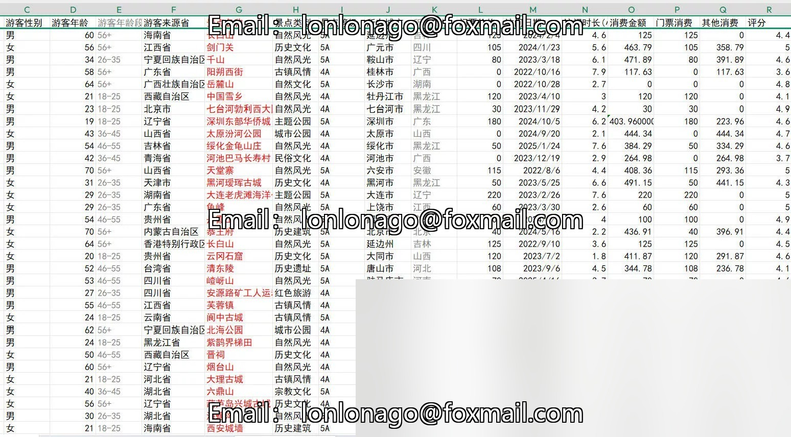

# National tourist attraction data analysis tourist tourism dataset

## Body

National tourist attraction data analysis visitor tourism dataset
A total of over 130,000 items
Time span: 2021-2026.2
Visitor ID, age, gender, origin, tourism duration, tourism method, number of attractions, consumption amount, attraction name, type, ticket price, location, date, description, sales volume, year, month, quarter, weekday, per capita daily consumption, age group, satisfaction, sentiment, year, month, day, and other detailed fields; with a large amount of data, suitable for research analysis, project development, writing, data research, etc.~

web-based shipment, can be directly photographed and shipped.

The dataset covers national tourist analysis and visitor travel data with over 130,000 records, including fields for visitor gender, age, origin, attraction names, types, levels, cities, provinces, ticket prices, visit dates, durations and consumption.

<!-- AI_ENRICHED -->

## Images

## Payment

Here is a pay link on Stripe ( https://buy.stripe.com/3cs8yP7sY87d0vu9AB ). Please contact me lonlonago@foxmail.com after funding $89, and I will send you a complete data files , thank you!

